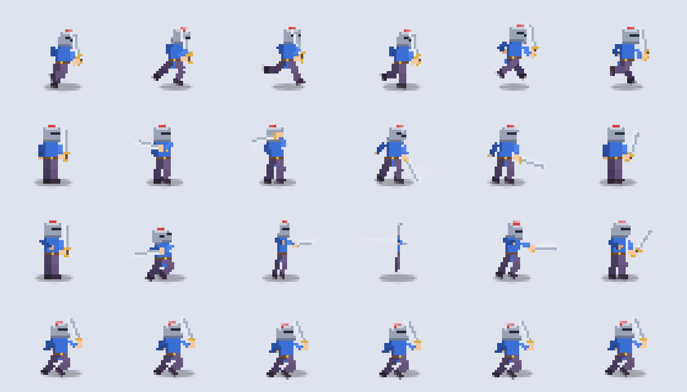

# Spruppet

**A free, open-source sprite puppet maker.** Draw a character once, mark its arms, legs and joints, and Spruppet animates it: idle, walk, run, jumps, nine sword attacks, guards and more. Export sprite sheets and frame data for your game.

**[Open Spruppet →](https://halfglassendless.github.io/spruppet/)**



It runs entirely in your browser. Nothing is uploaded anywhere: your drawings, rigs and saved versions stay on your computer.

## What it does

- **Brings in any drawing.** PNG, JPEG, WebP or GIF. Backgrounds are removed, and you choose a look: chunky pixel art at the size you pick, or a smooth HD drawing that keeps your own lines.
- **Rigs it with a brush.** Paint each part (torso, hips, head, arms, hands, legs, feet, weapon, shield, tail or cape, wings, eyes, ears, nose), then place the joints. A Joints checklist tells you exactly where each one goes ("Knee: the middle of the kneecap") and warns about placements that will look wrong.
- **Animates it.** Moves (idle, walk, run, dodge, jump, float, fly, glide, hit, sway, jelly, turn), one-hand attacks 1–5, two-hand attacks 1–4, charge attacks, parry, ready, block and counter. Eyes blink, ears flick, capes and tails trail behind.
- **Fills the gaps.** Joints get rounded fills and hidden parts are completed, so limbs don't tear apart when they swing.
- **Exports for games.** One sprite sheet per motion or all motions at once (.png), plus a .json file with frame rectangles, the feet pivot and every joint position. 12, 24, 30 or 60 fps.
- **Saves your work.** Versions in your browser, or a project file you can move between computers.

## Use it

Open the live site, or download `index.html` and open it in any modern browser (Chrome, Firefox, Edge, Safari). There's nothing to install.

1. **Sprite:** upload a drawing, pick which way it faces and whether it's side-on or turned toward you, then pick a look.
2. **Parts:** paint the parts with the brush or box tool, or press *Guess parts* and touch it up.
3. **Joints:** click each row in the Joints tab, then click that spot on the drawing.
4. **Motion and export:** pick a motion, tune it, and export.

Try the built-in Knight and Mushroom samples first to see how a finished rig looks.

## Run it locally

Opening `index.html` straight from your disk works. To serve it like a website instead:

```bash
python3 -m http.server 8000
```

Then visit <http://localhost:8000>.

## Contributing

Ideas, bug reports and pull requests are welcome. Please open an issue first for big changes so we can talk it through.

The whole app is one file, `index.html`, with no build step and no dependencies (fonts come from Google Fonts). Edit it, reload the page, and test with the Knight sample plus a drawing of your own. Please keep it a single file that opens straight from disk.

### Where things are in `index.html`

The script is split into sections, each starting with a `// ---------- Name ----------` comment:

| Section | What it does |
| --- | --- |
| Skeleton | The parts, their parents and the drawing order |
| Samples, Gear rack, Wings | The built-in knight and mushroom, weapons, hats and wings |
| Motions | Every animation, as keyframes or formulas |
| Rig building | Splits the drawing into one layer per part |
| Gap fillers | Round joint fills, hidden-part fill-in and cel shading |
| Posing | Joint chain math, the torso bend, two-hand grips |
| Renderer | Draws each frame: parts, trails, glow, sparks, dust |
| Rig editor | Painting parts and placing joints, plus the Joints guide |
| Image tools | Resolution, resizing, cutting, erasing, edge clean-up |
| Upload setup, Loading sprites | Converting uploads to pixel art or HD |
| Project, Export | Versions, project files, sprite sheets and JSON |

## License

[MIT](LICENSE). Use it, change it, and ship games made with it, including commercial ones.
